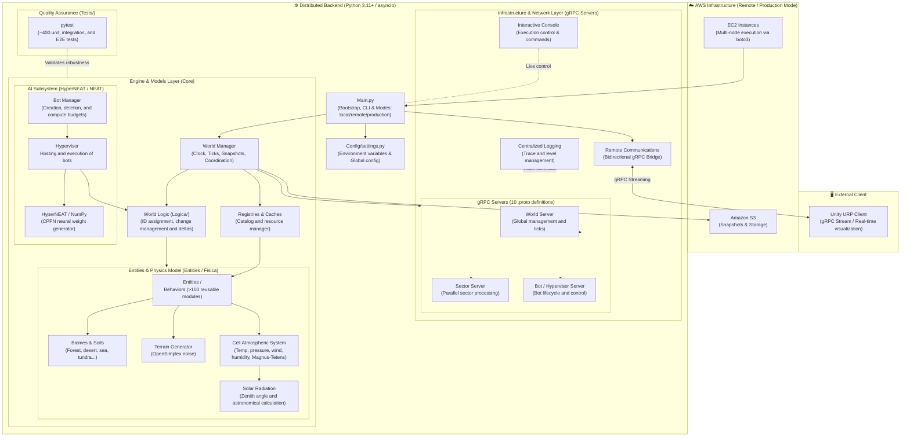

**🌐 [Español](README.md) · English**

# AGEA

> A living-world simulator where agents controlled by evolving neural networks (**HyperNEAT**) survive and interact with a simulated physical environment: climate, terrain, biomes, and objects with behaviors of their own.

<!--  -->

**Status:** under active development · **Author:** [Sergio Domínguez Soto](https://github.com/sergiod-soto) [[Linkedin](https://www.linkedin.com/in/sergio-dominguez-soto)]

---

## What is AGEA?


AGEA is a simulation environment where **agent intelligence is evolved rather than programmed**. The world is computed turn by turn (*ticks*), is divided into sectors that can run as independent processes, and each agent chooses its actions using a neural network generated through HyperNEAT.

The project was designed from the start to **scale**: the whole system can run on a single machine (local mode) or be distributed across AWS instances (remote mode).

## Features

- **Sector-based world.** A 25,000,000 cell grid (configurable) split into 100×100 sectors computed in parallel.
- **Biomes and soils.** Forest, desert, sea, grassland, jungle, taiga and tundra; stone, sand, mud, grass, gravel, ice and water soils. Terrain generated with noise (OpenSimplex).
- **Per-cell atmospheric system.** Temperature, pressure, wind and humidity (absolute and relative). Solar radiation is computed with the astronomical zenith-angle formula, so seasons emerge on their own (more extreme near the poles, reversed in the southern hemisphere). Air saturation uses Magnus-Tetens and the ideal gas law.
- **Entities built from composable behaviors.** Over 100 reusable modules (health, energy, material, terrain, time, interaction, perception, social, stats…) that combine to define any element in the world.
- **Evolutionary AI.** A custom HyperNEAT implementation on top of `neat-python` and `numpy`: a small network (CPPN) generates the weights of the large network that acts as the agent's brain.
- **Distributed architecture.** Independent components communicating over **gRPC + Protocol Buffers** (10 `.proto` definitions), with heartbeats, graceful shutdown and centralized logging.
- **Execution control.** Pause, tick-by-tick stepping, bot freezing, snapshot saving and loading, and an interactive console.
- **AWS deployment.** Infrastructure launched on EC2 with storage on S3 through `boto3`.
- **Unity visualization.** A client subscribed to a gRPC stream receives the region of the world to be displayed.

## Architecture



> The diagram is a simplified view. The exact topology (how many sectors, how many hypervisors, ports) is defined in `Infraestructura/Gestores/Bootstrap/topologia.py`.

| Component | Responsibility |
|---|---|
| **World Manager** (`gestor_mundo`) | Drives the simulation clock (pause, tick advance, saving) and creates the sectors. |
| **Sectors** (`sector`) | Each one simulates its slice of terrain and atmosphere and returns the changes (*deltas*) of every tick. |
| **World Logic** (`logica_mundo`) | Creates, modifies and removes elements, assigns IDs and resolves agent actions. |
| **Bot Manager** (`gestor_bots`) | Spawns and kills bots, distributes compute budgets and handles snapshots. |
| **Hypervisor** (`hypervisor`) | Hosts and runs the bots (with a configurable limit per instance). |
| **Remote Communications** (`comunicaciones_remoto`) | Single bridge between the local environment and AWS; serves the visualization stream to Unity. |

> Note: the source code (identifiers, folders, comments) is written in Spanish, so the Spanish names are given in parentheses.

## Repository layout

```
AGEA/
├── python/                  # Simulation backend
│   ├── Main.py              # Entry point (local / remote / production modes)
│   ├── Config/              # Centralized configuration (environment variables)
│   ├── Core/
│   │   ├── Entities/        # World, biomes, soils, atmosphere and behaviors
│   │   ├── Fisica/          # Thermodynamic functions
│   │   ├── HyperNEAT/       # HyperNEAT implementation
│   │   └── Logica/          # Bot and entity logic
│   ├── Infraestructura/
│   │   ├── Gestores/        # Components, bootstrap, gRPC transport, console and logs
│   │   └── AWS/             # EC2 / S3 orchestration
│   ├── Services/            # Cache services
│   ├── Utils/               # Utilities (geometry, files, sound…)
│   ├── DEV/                 # Test scenarios and example bot
│   ├── Tests/               # Test suite (pytest)
│   └── compile_protos.py    # Compiles the .proto files
└── unity/                   # Unity project (visualization client)
```

## Requirements

- **Python 3.11 or higher** (recommended)
- **Unity 6000.4** (only if you want to use the viewer)
- An AWS account (only for remote mode)

Python dependencies (inferred from the code; there is no `requirements.txt` yet):

```bash
pip install grpcio grpcio-tools protobuf neat-python numpy scipy opensimplex \
            boto3 pyyaml psutil bitarray vectors requests pillow matplotlib \
            librosa pytest pytest-asyncio
```

## Getting started

Run all commands from the `python/` folder.

### 1. Compile the protobufs

The generated files are not committed to the repository, so they must be created once:

```bash
cd python
python compile_protos.py
```

### 2. Configure the environment

Copy or create a `.env.local` file with, at minimum, the import root:

```bash
PYTHONPATH=.
```

World parameters (`GRID_WIDTH`, `GRID_HEIGHT`, `SECTOR_SIZE`, `LOG_LEVEL`, `FRESH`…) are read from `Config/settings.py` and can be overridden with environment variables.

### 3. Run in local mode

Starts the whole system as subprocesses on your machine:

```bash
# Linux / macOS
FRESH=true python Main.py --modo local
```

```powershell
# Windows (PowerShell)
$env:FRESH="true"; python Main.py --modo local
```

`FRESH=true` ignores saved snapshots and starts a new game. To load a specific test scenario:

```bash
python Main.py --modo local --escenario <name>
```

Available scenarios are registered in `DEV/Escenarios/escenarios.py`.

### 4. Remote and production modes

```bash
python Main.py --modo remoto        # Launches the infrastructure on AWS (requires config.yaml)
python Main.py --modo produccion --componente sector --id sector_0_1 --sesion <id> --bucket <bucket>
```

Instance, network and timeout settings live in `Infraestructura/AWS/config.yaml`.

## Tests

```bash
cd python
pytest                    # whole suite
pytest -m unit            # pure tests, no network
pytest -m integration     # real components working together (in-process gRPC)
pytest -m e2e             # full stack as subprocesses
```


## Tech stack

Python · gRPC · Protocol Buffers · HyperNEAT / NEAT · NumPy · SciPy · asyncio · AWS (EC2, S3) · Unity (URP) · pytest

## License

<!-- TODO: pick a license (e.g. MIT) and add a LICENSE file. Without one, nobody is legally allowed to reuse your code. -->
