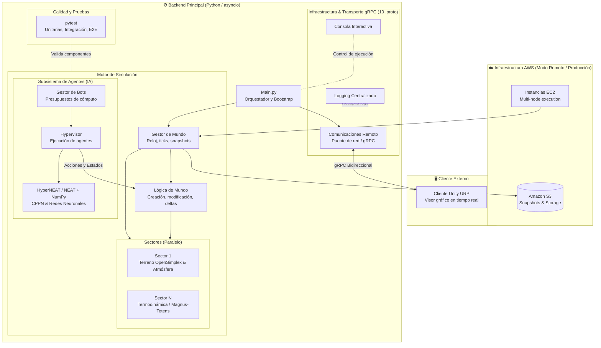

**🌐 Español · [English](README.en.md)**

# AGEA

> Simulador de un mundo vivo en el que agentes controlados por redes neuronales evolutivas (**HyperNEAT**) sobreviven e interactúan con un entorno físico simulado: clima, terreno, biomas y objetos con comportamientos propios.

<!-- TODO: añade aquí una captura o un GIF de Unity mostrando el mundo. Es lo que más impacto causa. -->
<!--  -->

**Estado:** en desarrollo activo · **Autor:** [Sergio Domínguez Soto](https://github.com/sergiod-soto)

---

## ¿Qué es AGEA?


AGEA es un entorno de simulación donde **la inteligencia de los agentes se evoluciona en lugar de programarse**. El mundo se calcula por turnos (*ticks*), está dividido en sectores que pueden ejecutarse como procesos independientes, y cada agente decide sus acciones con una red neuronal generada mediante HyperNEAT.

El proyecto está pensado desde el principio para **escalar**: todo el sistema puede ejecutarse en una sola máquina (modo local) o repartirse en instancias de AWS (modo remoto).

## Características

- **Mundo simulado por sectores.** Malla de 300×200 celdas (configurable) dividida en sectores de 100×100 que se calculan en paralelo.
- **Biomas y suelos.** Bosque, desierto, mar, pradera, selva, taiga y tundra; suelos de piedra, arena, barro, césped, grava, hielo y agua. Generación del terreno con ruido (OpenSimplex).
- **Sistema atmosférico por celda.** Temperatura, presión, viento y humedad (absoluta y relativa). La radiación solar se calcula con la fórmula astronómica del ángulo cenital, de modo que las estaciones aparecen solas (más extremas cerca de los polos, invertidas en el hemisferio sur). La saturación del aire usa Magnus-Tetens y la ley de los gases ideales.
- **Entidades por composición de comportamientos.** Más de 100 módulos reutilizables (salud, energía, material, terreno, temporalidad, interacción, percepción, social, estadísticas…) que se combinan para definir cualquier elemento del mundo.
- **IA evolutiva.** Implementación propia de HyperNEAT sobre `neat-python` y `numpy`: una red pequeña (CPPN) genera los pesos de la red grande que actúa como cerebro del agente.
- **Arquitectura distribuida.** Componentes independientes que se comunican por **gRPC + Protocol Buffers** (10 definiciones `.proto`), con heartbeats, apagado ordenado y logging centralizado.
- **Control de ejecución.** Pausa, avance tick a tick, congelación de bots, guardado y carga de *snapshots*, y una consola interactiva.
- **Despliegue en AWS.** Arranque de la infraestructura en EC2 y almacenamiento en S3 mediante `boto3`.
- **Visualización en Unity.** Un cliente suscrito a un stream gRPC recibe la región del mundo que se quiere observar.

## Arquitectura



> El diagrama es una vista simplificada. La topología exacta (cuántos sectores, cuántos hypervisors, puertos) se define en `Infraestructura/Gestores/Bootstrap/topologia.py`.

| Componente | Responsabilidad |
|---|---|
| **Gestor de Mundo** | Orquesta el reloj de la simulación (pausa, avance de tick, guardado) y crea los sectores. |
| **Sectores** | Cada uno simula su porción del terreno y la atmósfera, y devuelve los cambios (*deltas*) de cada tick. |
| **Lógica de Mundo** | Crea, modifica y elimina elementos, asigna IDs y resuelve las acciones de los agentes. |
| **Gestor de Bots** | Crea y elimina bots, reparte presupuestos de cómputo y gestiona snapshots. |
| **Hypervisor** | Aloja y ejecuta los bots (con un límite configurable por instancia). |
| **Comunicaciones Remoto** | Puente único entre el entorno local y AWS; sirve el stream de visualización a Unity. |

## Estructura del repositorio

```
AGEA/
├── python/                  # Backend de la simulación
│   ├── Main.py              # Punto de entrada (modos local / remoto / producción)
│   ├── Config/              # Configuración centralizada (variables de entorno)
│   ├── Core/
│   │   ├── Entities/        # Mundo, biomas, suelos, atmósfera y comportamientos
│   │   ├── Fisica/          # Funciones termodinámicas
│   │   ├── HyperNEAT/       # Implementación de HyperNEAT
│   │   └── Logica/          # Lógica de bots y entidades
│   ├── Infraestructura/
│   │   ├── Gestores/        # Componentes, bootstrap, transporte gRPC, consola y logs
│   │   └── AWS/             # Orquestación en EC2 / S3
│   ├── Services/            # Servicio de cachés
│   ├── Utils/               # Utilidades (geometría, ficheros, sonido…)
│   ├── DEV/                 # Escenarios de prueba y bot de ejemplo
│   ├── Tests/               # Suite de pruebas (pytest)
│   └── compile_protos.py    # Compila los .proto
└── unity/                   # Proyecto de Unity (cliente de visualización)
```

## Requisitos

- **Python 3.11 o superior** (recomendado)
- **Unity 6000.4** (solo si quieres usar el visor)
- Cuenta de AWS (solo para el modo remoto)

Dependencias de Python (deducidas del código; no hay aún un `requirements.txt`):

```bash
pip install grpcio grpcio-tools protobuf neat-python numpy scipy opensimplex \
            boto3 pyyaml psutil bitarray vectors requests pillow matplotlib \
            librosa pytest pytest-asyncio
```

## Puesta en marcha

Todos los comandos se ejecutan desde la carpeta `python/`.

### 1. Compilar los protobufs

Los ficheros generados no se suben al repositorio, así que hay que crearlos una vez:

```bash
cd python
python compile_protos.py
```

### 2. Configurar el entorno

Copia o crea un fichero `.env.local` con, al menos, la raíz de imports:

```bash
PYTHONPATH=.
```

Los parámetros del mundo (`GRID_WIDTH`, `GRID_HEIGHT`, `SECTOR_SIZE`, `LOG_LEVEL`, `FRESH`…) se leen de `Config/settings.py` y pueden sobreescribirse con variables de entorno.

### 3. Arrancar en modo local

Levanta todo el sistema como subprocesos en tu máquina:

```bash
# Linux / macOS
FRESH=true python Main.py --modo local
```

```powershell
# Windows (PowerShell)
$env:FRESH="true"; python Main.py --modo local
```

`FRESH=true` ignora los snapshots guardados y empieza una partida nueva. Para cargar un escenario de pruebas concreto:

```bash
python Main.py --modo local --escenario <nombre>
```

Los escenarios disponibles están registrados en `DEV/Escenarios/escenarios.py`.

### 4. Modos remoto y producción

```bash
python Main.py --modo remoto        # Lanza la infraestructura en AWS (requiere config.yaml)
python Main.py --modo produccion --componente sector --id sector_0_1 --sesion <id> --bucket <bucket>
```

La configuración de instancias, red y tiempos de espera está en `Infraestructura/AWS/config.yaml`.

## Tests

```bash
cd python
pytest                    # toda la suite
pytest -m unit            # pruebas puras, sin red
pytest -m integration     # componentes reales colaborando (gRPC en proceso)
pytest -m e2e             # stack completo como subprocesos
```


## Tecnologías

Python · gRPC · Protocol Buffers · HyperNEAT / NEAT · NumPy · SciPy · asyncio · AWS (EC2, S3) · Unity (URP) · pytest

## Licencia

<!-- TODO: elige una licencia (por ejemplo MIT) y añade un fichero LICENSE. Sin licencia, legalmente nadie puede reutilizar tu código. -->
